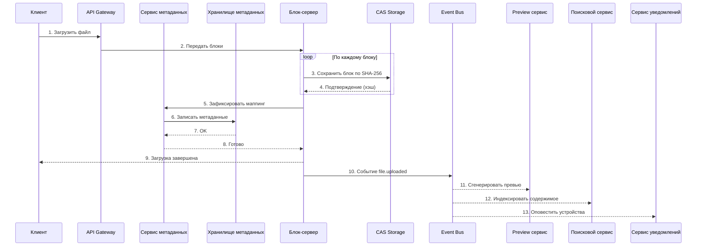
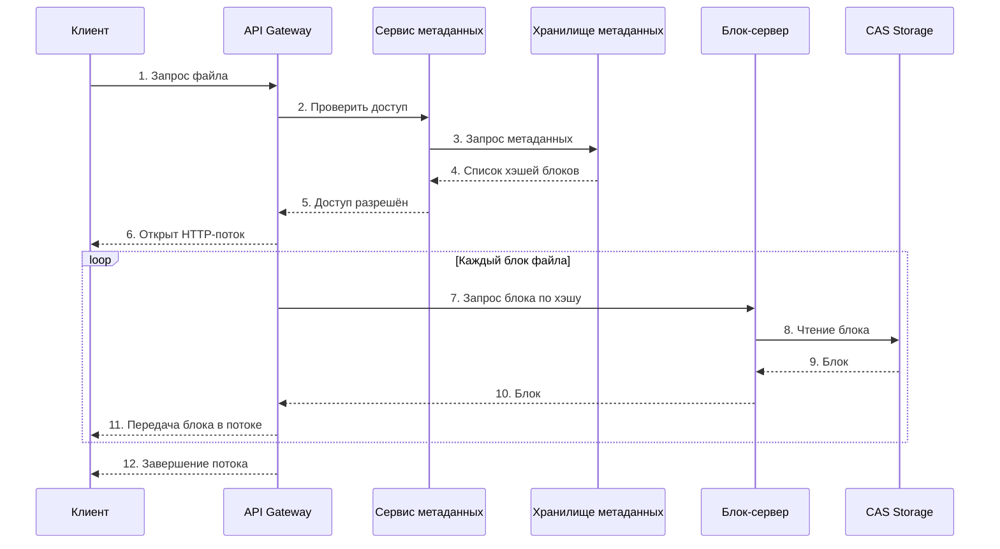
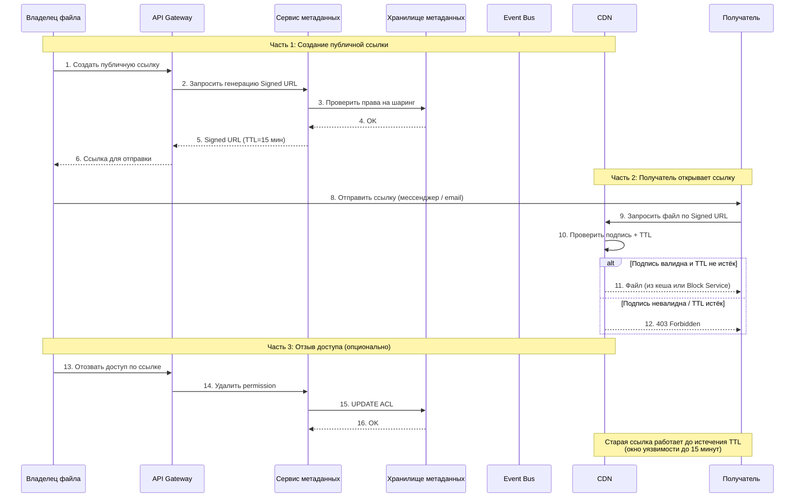

# ДЗ 1. Анализ референсной архитектуры — решение

## Выбранная архитектура

Облачное хранилище

## 1. Компоненты

### 1.1 Api gateway

Принимает запросы (загрузка, скачивание, шаринг, удаление).  
Проверяет аутентификацию, ограничивает частоту запросов и маршрутизирует трафик.

### 1.2 Очередь сообщений (Event Bus)

Асинхронная доставка событий подписчикам. События: `file.uploaded`, `file.changed`, `file.deleted`, `file.shared`.  
Подписчики: генератор превью, поисковый индексатор, сервис уведомлений.

### 1.3 Сервис метаданных (поверх хранилища метаданных)

Предоставляет API для работы с деревом каталогов: создать папку, переместить файл, получить список файлов, изменить права доступа, получить версии файла.  
Содержит бизнес-логику: проверка прав, разрешение конфликтов, Signed URLs.

### 1.4 Хранилище (база данных) метаданных

Хранит метаинформацию (размер, дата, владелец), права доступа, версионирование файлов и маппинг (пути к файлам и список блоков).

### 1.5 Блок-сервис

Принимает блоки данных, проверяет целостность, отправляет на хранение в CAS.
Отдает блоки.

### 1.6 CAS Storage (объектное хранилище)

Хранит блоки данных, адресуемые по хэшу.  
Обеспечивает дедупликацию.  
Управляет репликацией и Erasure Coding.

### 1.7 Сервис уведомлений

Уведомление пользователей о событиях с их файлами.

### 1.8 Поисковой сервис

Индексирует имена файлов, содержимое, метатеги.  
Отвечает на поисковые запросы.  
Обеспечивает быстрый поиск файлов по ключевым словам, типу, дате, владельцу, содержимому.  

### 1.9 Preview сервис

Генерирует миниатюры для изображений, видео, PDF, документов.  
Сохраняет их в отдельное хранилище или в CAS с особым префиксом.  
Отдаёт превью при просмотре папки.

### 1.10 CDN

Кеширует горячие файлы на ближайших к пользователю серверах.

## 2. Потоки данных

### 2.1 Загрузка нового файла

* Клиент разбивает файл на блоки и вычисляет хеш каждого блока.
* Блоки передаются через API Gateway на Блок-сервис.
* Блок-сервер сохраняет каждый блок в CAS Storage.
* После сохранения всех блоков Блок-сервис фиксирует маппинг через Сервис метаданных в Хранилище метаданных.
* Клиент получает подтверждение об успешной загрузке.

Шаги 1–9 синхронно. Пользователь видит прогресс-бар и получает подтверждение только после полной записи всех блоков и метаданных.

Шаги 10–13 (генерация превью, индексация поиска и уведомления других устройств) асинхронно.

### 2.2 Скачивание файла

* Клиент отправляет запрос на скачивание файла в API Gateway (с токеном авторизации).
* API Gateway обращается к Сервису метаданных для проверки прав и получения списка хэшей блоков, из которых состоит файл.
* Сервис метаданных читает информацию из Хранилища метаданных и возвращает список хэшей.
* API Gateway открывает HTTP-поток к клиенту и последовательно запрашивает каждый блок у Блок-сервера.
* Блок-сервер читает блоки из CAS Storage и возвращает их в API Gateway.
* API Gateway по мере получения блоков отправляет их клиенту в потоковом режиме.

### 2.3 Шаринг ссылки на файл

1. Создание ссылки  
Владелец запрашивает публичную ссылку. API Gateway через Сервис метаданных проверяет права и генерирует Signed URL.

2. Использование ссылки  
Получатель переходит по ссылке → CDN проверяет подпись и TTL самостоятельно (без вызова сервиса метаданных) → при успехе отдаёт файл.

3. Отзыв доступа  
Владелец отзывает доступ. Сервис метаданных обновляет ACL в БД. Новые Signed URL генерироваться не будут, но старые продолжают работать до истечения TTL.

## 3. Проблемы и решения

### API Gateway

Решает проблемы: как защитить внутренние сервисы от внешних запросов, где проверять аутентификацию.

Единая точка входа, проверяет токены, ограничивает частоту запросов, проксирует запросы к внутренним сервисам (метаданных, блок-серверу).

### Очередь сообщений

Решает проблемы: как не блокировать пользователя фоновыми задачами, что делать при временной недоступности сервисов.

Обеспечивает асинхронную обработку (превью, поиск, уведомления) и сохраняет события до восстановления.

### Сервис метаданных

Решает проблемы: где хранить информацию о файлах и правах, как проверять доступ, как управлять деревом каталогов.

Предоставляет API для работы с базой данных метаданных, версиями и ACL. Генерирует Signed URLs для публичного доступа.

### Хранилище метаданных

Решает проблемы: как хранить миллиарды записей, как выдержать высокую нагрузку, как не потерять данные.

Использует шардирование для масштабирования и репликацию для отказоустойчивости.

### Блок-сервис

Решает проблемы: как загружать гигабайтные файлы без потерь при обрыве, как не передавать файл заново при малом изменении.

### CAS Storage

Решает проблемы: как не хранить одинаковые файлы многократно, как восстановить данные при отказе диска.

Хранит блоки по хэшу, использует репликацию или Erasure Coding для надёжности.

### Сервис уведомлений

Решает проблемы: как устройства узнают об изменениях без постоянного опроса сервера.

WebSocket-соединение или оpush-уведомления.

### Preview сервис

Решает проблемы: как показывать миниатюры тысяч файлов, не скачивая каждый оригинал, и как не заставлять пользователя ждать.

Асинхронно генерирует превью через Event Bus и сохраняет их отдельно.

### Поисковой сервис

Решает проблемы: как найти файл по слову внутри документа за секунды, как не сканировать все файлы при каждом поиске.

Строит инвертированный индекс по содержимому документов.

## 4. Вопросы к авторам архитектуры

1. Как вы выбрали размер блока — 4MB, 8MB или 64MB? Что будет, если сделать блок слишком маленьким или слишком большим?

2. CDN сохраняет файлы целиком или отдельными блоками? Если блоком — как CDN узнаёт, какие блоки нужны? Если целиком — как обновить файл в CDN при малом изменении?

3. В схеме API Gateway собирает файл из блоков при скачивании. Не станет ли это узким местом при большом количестве параллельных скачиваний? Как масштабировать Gateway под такой сценарий?

4. Если пользователь переименовывает папку с 10 000 файлов, что происходит внутри? Меняется один путь в метаданных или обновляется запись каждого файла? Как долго это занимает?

5. В сценарии загрузки события идут в Event Bus после фиксации метаданных. Что будет, если Event Bus недоступен в этот момент — файл сохранён, но превью и поиск не получили событие. Как вы обнаруживаете и обрабатываете такие пропущенные события?
