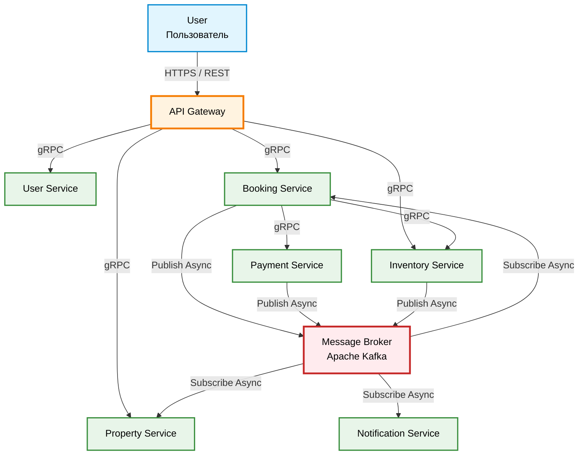

# ДЗ 2. Проектирование взаимодействия сервисов — решение

## Выбранная система

Cервис бронирования

## 1. Декомпозиция

### 1.1 API Gateway

Единая точка входа для всех клиентских запросов.  
Маршрутизация запросов, агрегация данных, аутентификация, ограничение частоты запросов (rate limiting).

### 1.2 User Service

Регистрация, аутентификация, управление профилем, роли, программы лояльности, отзывы, предпочтения.

### 1.3 Property Service

Управление объектами размещения (категории, услуги, геолокация, фото, описания и т.д).  
Поиск и фильтрация объектов.

### 1.4 Inventory Service

Управление элементами для бронирвоания, датами, ценами, скидками. Блокировка на время бронирования.

### 1.5 Booking Service

Информция о бронированиях. Оркестрация процесса создания, изменения, оплаты и отмены брони.

### 1.6 Payment Service

Обработка платежей, выплаты, отмены. Хранение методов оплаты.

### 1.6 Notification Service

Отправка email, SMS, push-уведомлений о статусе бронирования, напоминаний, маркетинговых сообщений.

### 1.7 Message Broker (Kafka)

Асинхронная доставка событий между сервисами

## 2. Протоколы

### HTTPS / REST

- `Client` → `API Gateway`

Протокол который гарантированно работает в браузерах и мобильных приложениях без дополнительных библиотек. HTTP-кэширование, сжатие, CDN.

### gRPC

- `API Gateway` → все сервисы
- `Booking` → `Inventory`
- `Booking` → `Payment`

Protobuf компактнее JSON, строгая типизация исключает ошибки контрактов, HTTP/2 multiplexing позволяет обрабатывать множество запросов в одном соединении.

### Message broker

- `Booking` → `Kafka` (события бронирования, команда на оплату)
- `Payment` → `Kafka` (статус платежа)
- `Inventory` → `Kafka` (изменение цен и доступности)
- `Kafka` → `Notification`, `Booking`, `Property` (подписки)

Асинхронность там, где результат не нужен пользователю немедленно. Уведомления, инвалидация кэша, ожидание ответа от платежного шлюза не должны блокировать основной поток.

## 3. Схема взаимодействия



## 4. API-контракты

```yaml
openapi: 3.0.3
info:
  title: Booking System API
  description: API Gateway для системы бронирования
  version: 1.0.0
servers:
  - url: https://api.mybooking.com/v1

paths:
  /properties/search:
    get:
      summary: Поиск объектов размещения
      parameters:
        - name: city
          in: query
          required: true
          schema:
            type: string
            example: Moscow
        - name: check_in
          in: query
          required: true
          schema:
            type: string
            format: date
            example: "2026-07-23"
        - name: check_out
          in: query
          required: true
          schema:
            type: string
            format: date
            example: "2026-07-27"
        - name: guests
          in: query
          required: true
          schema:
            type: integer
            example: 2
      responses:
        "200":
          description: Результаты поиска
          content:
            application/json:
              schema:
                $ref: "#/components/schemas/SearchResponse"
        "400":
          description: Ошибка валидации
          content:
            application/json:
              schema:
                $ref: "#/components/schemas/Error"

  /bookings:
    post:
      summary: Создание бронирования
      requestBody:
        required: true
        content:
          application/json:
            schema:
              $ref: "#/components/schemas/CreateBookingRequest"
      responses:
        "200":
          description: Бронирование создано
          content:
            application/json:
              schema:
                $ref: "#/components/schemas/BookingResponse"
        "409":
          description: Номер недоступен
          content:
            application/json:
              schema:
                $ref: "#/components/schemas/Error"

  /bookings/{booking_id}:
    get:
      summary: Статус бронирования
      parameters:
        - name: booking_id
          in: path
          required: true
          schema:
            type: string
            example: "oWJjZDQ1NjgtOTBlZi1naGlq"
      responses:
        "200":
          description: Статус бронирования
          content:
            application/json:
              schema:
                $ref: "#/components/schemas/BookingResponse"
        "404":
          description: Бронирование не найдено
          content:
            application/json:
              schema:
                $ref: "#/components/schemas/Error"

  /bookings/{booking_id}/cancel:
    post:
      summary: Отмена бронирования
      parameters:
        - name: booking_id
          in: path
          required: true
          schema:
            type: string
            example: "oWJjZDQ1NjgtOTBlZi1naGlq"
      requestBody:
        required: true
        content:
          application/json:
            schema:
              $ref: "#/components/schemas/CancelRequest"
      responses:
        "200":
          description: Бронирование отменено
          content:
            application/json:
              schema:
                $ref: "#/components/schemas/BookingResponse"
        "422":
          description: Отмена невозможна
          content:
            application/json:
              schema:
                $ref: "#/components/schemas/Error"

components:
  schemas:
    SearchResponse:
      type: object
      properties:
        total:
          type: integer
          example: 42
        properties:
          type: array
          items:
            $ref: "#/components/schemas/PropertyCard"

    PropertyCard:
      type: object
      properties:
        property_id:
          type: string
          example: "oWJjZDQ1NjgtOTBlZi1naGlq"
        name:
          type: string
          example: "Отель Москва"
        address:
          type: string
          example: "ул. Тверская, 1"
        rating:
          type: number
          example: 4.7
        thumbnail_url:
          type: string
          format: uri
        rooms:
          type: array
          items:
            $ref: "#/components/schemas/RoomCard"

    RoomCard:
      type: object
      properties:
        room_type_id:
          type: string
          example: "oWJjZDQ1NjgtOTBlZi1naGlq"
        name:
          type: string
          example: "Стандартный номер"
        total_price:
          type: number
          example: 3200.00
        currency:
          type: string
          example: "RUB"
        rooms_left:
          type: integer
          example: 3

    CreateBookingRequest:
      type: object
      required:
        - property_id
        - room_type_id
        - check_in
        - check_out
        - guests
        - primary_guest
      properties:
        property_id:
          type: string
          example: "oWJjZDQ1NjgtOTBlZi1naGlq"
        room_type_id:
          type: string
          example: "oWJjZDQ1NjgtOTBlZi1naGlq"
        check_in:
          type: string
          format: date
          example: "2026-07-23"
        check_out:
          type: string
          format: date
          example: "2026-07-27"
        guests:
          type: integer
          example: 2
        primary_guest:
          $ref: "#/components/schemas/GuestInfo"

    GuestInfo:
      type: object
      properties:
        first_name:
          type: string
          example: "Иван"
        last_name:
          type: string
          example: "Петров"
        email:
          type: string
          format: email
          example: "ivan@example.com"
        phone:
          type: string
          example: "+79991234567"

    CancelRequest:
      type: object
      properties:
        reason:
          type: string
          example: "changed_plans"

    BookingResponse:
      type: object
      properties:
        booking_id:
          type: string
          example: "qf71Hg9501001fkgldoo124r"
        status:
          type: string
          enum: [pending_payment, confirmed, cancelled, failed]
        payment_url:
          type: string
          format: uri
          description: Ссылка на страницу оплаты (если статус pending_payment)
        failure_reason:
          type: string
          description: Причина ошибки (если статус failed)
        refund_amount:
          type: number
          description: Сумма возврата (если статус cancelled)
        currency:
          type: string
          example: "RUB"
        details:
          $ref: "#/components/schemas/BookingDetails"

    BookingDetails:
      type: object
      properties:
        property_name:
          type: string
          example: "Отель Москва"
        room_name:
          type: string
          example: "Стандартный номер"
        check_in:
          type: string
          format: date
          example: "2026-07-23"
        check_out:
          type: string
          format: date
          example: "2026-07-27"
        total_price:
          type: number
          example: 3200.00
        currency:
          type: string
          example: "RUB"

    Error:
      type: object
      properties:
        error:
          type: string
          example: "room_unavailable"
        message:
          type: string
          example: "Номер только что забронировали. Выберите другой вариант"
```

## 5. Асинхронность

Почти все взаимодействие в системе синхронно. Гость всегда инициирует действие и ждёт ответ: поиск, бронирование, создание счёта, отмена, логин.
Асинхронность используется для взаимодействия с платежным шлюзом, уведомлений и обновления поисковых данных.

- `Payment` → `Booking`

  Cтатус оплаты от эквайера приходит с задержкой. Booking обновляет бронь, когда получит результат.

- `Booking` → `Notification`

  Отправка писем и push.

- `Inventory` → `Property`

  Обновление поискового кэша.

## 6. Паттерны

### 6.1 Saga

`Booking Service` - оркестратор

Гарантия консистентность без распределённых транзакций. Сценарий легко отследить и отладить.

Создание брони — распределённая транзакция между тремя сервисами. Booking выступает оркестратором:

- Вызвать Inventory — заблокировать номер.
- Вызвать Payment — создать счёт.
- При получении отказа платежа — вызвать Inventory для освобождения номера (компенсация).

### 6.2 CQRS

`Property Service`

Чтение (поиск с фильтрами, гео-выборки) нагружает систему в сотни раз сильнее записи (создание объявления). Данные разделены: командная модель пишет в PostgreSQL, модель чтения использует Elasticsearch. События от `Inventory` асинхронно обновляют поисковый индекс. Позволяет оптимизировать поиск без влияния на производительность записи.

### 6.3 API Gateway

Скрывает внутреннюю структуру микросервисов, упрощает клиентскую логику, снижает количество запросов, занимается аутентификацией, TLS-терминацией, агрегацией ответов.

### 6.4 Outbox

`Booking Service`, `Payment Service`, `Inventory Service`

Исключает ситуацию, когда БД обновилась, а событие потерялось. Гарантирует согласованность между состоянием сервиса и опубликованными событиями.
