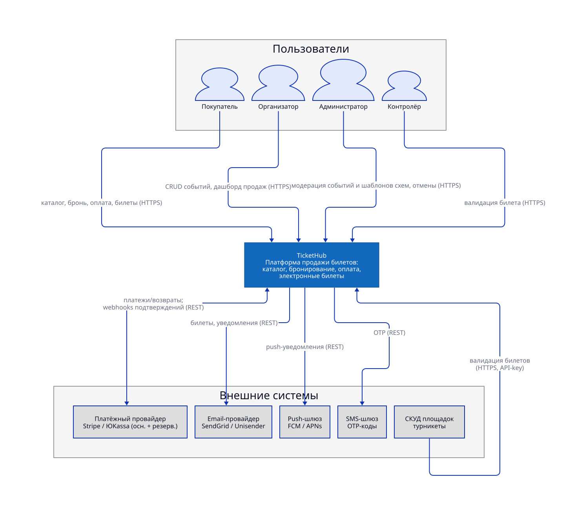
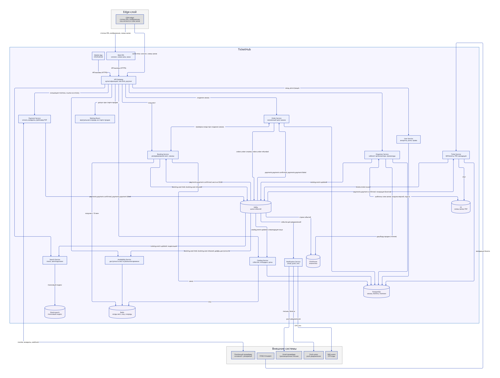

# 2. Концептуальная архитектура

## 2.1 Схема концептуальной архитектуры (C4: Context + Container)

### C4 Level 1 — System Context

Исходник: [diagrams/c4-context.d2](../diagrams/c4-context.d2) (D2, layout: ELK).

### C4 Level 2 — Containers

Исходник: [diagrams/c4-container.d2](../diagrams/c4-container.d2) (D2, layout: ELK).

## 2.2 Описание компонентов

Компоненты системы и их зоны ответственности. Хранилища, через которые компоненты обмениваются данными, показаны на диаграмме выше и детально разобраны в [04-data-storage](04-data-storage.md).

| Компонент | За что отвечает |
| --- | --- |
| **Web SPA / Mobile App** | Всё, что видит пользователь: каталог событий, схема зала с выбором мест, корзина и оформление заказа. |
| **API Gateway** | Единственная точка входа для всех запросов: проверяет, кто пользователь, ограничивает частоту обращений и направляет запросы в нужный сервис. |
| **Waiting Room (виртуальная очередь)** | На старте продаж популярного события не пускает всех сразу, а ставит пользователей в очередь и запускает внутрь контролируемым потоком, чтобы система не перегрузилась. |
| **Catalog Service** | Информация о событиях, площадках и артистах: карточки, расписания, цены. |
| **Search Service** | Поиск событий по названию, датам, городу; подсказки при вводе. |
| **Availability Service** | Карта зала в реальном времени: какие места свободны, заняты или уже проданы. |
| **Booking Service** | Резервирование выбранных мест на время оформления заказа (10 минут) и создание заказа. Гарантирует, что одно место не продастся дважды. |
| **Order Service** | Жизненный цикл заказа: статусы, история, отмена, возврат. |
| **Payment Service** | Проведение оплаты через внешние платёжные системы: сам выбирает провайдера, переключается на резервный при сбоях, обрабатывает возвраты. |
| **Ticket Service** | Превращает оплаченный заказ в билет: генерирует уникальный QR-код и PDF, проверяет билеты на входе. |
| **Notification Service** | Доводит до пользователя письма, push и sms: подтверждения, билеты, напоминания, изменения в заказе. |
| **User Service** | Аккаунты и профили пользователей, вход и регистрация, роли и права доступа. |
| **Organizer Service** | Личный кабинет организатора: создание и редактирование событий, квоты, отчёты о продажах. Владеет библиотекой шаблонов схем залов: загрузка, версионирование, апрув (администратор работает через этот же сервис — F-A-04) и публичная отдача шаблонов. |
| **Kafka (шина событий)** | Асинхронный обмен событиями между сервисами: заказ создан, оплата подтверждена, место освобождено и т.п. Развязывает сервисы — каждый читает нужные события независимо и не ждёт остальных. |

## 2.3 Обоснование архитектурного стиля

**Выбран: микросервисная event-driven архитектура.**

Причины:

1. **Неравномерность нагрузки.** Чтение (каталог, схема зала, доступность мест) генерирует 99% трафика и переживает пики до ×500 при старте продаж популярных событий, а запись (бронь, оплата) — малую, но критичную для бизнеса долю. Микросервисы позволяют масштабировать эти контуры независимо: добавляем реплики Catalog/Availability под наплыв зрителей, не трогая и не оплачивая лишнее масштабирование Booking/Payment.
2. **Разные требования к консистентности.** Системе нужны два разных режима работы с данными. Для заказов и платежей — строгая транзакционность (ACID): оплата и перевод места в «продано» выполняются либо полностью, либо никак, двойная продажа недопустима. Для каталога, поиска и уведомлений достаточно итоговой согласованности (eventual consistency): изменение цены или описания события доезжает до всех потребителей за секунды, и эта задержка не влияет на корректность продажи. Event-driven архитектура позволяет совместить оба режима: каждый сервис коммитит одну локальную транзакцию в своей базе и публикует событие, а остальные асинхронно строят свои read-модели (поисковый индекс, кэш, аналитику) из потока событий. Так мы избегаем распределённых транзакций сразу в нескольких хранилищах — они были бы медленными, хрупкими и стали бы узким местом под нагрузкой.
3. **Изоляция сбоев.** Недоступность поиска или уведомлений не должна останавливать продажи: покупатель оформляет заказ, даже если «упал» поиск. Событийная шина (Kafka) развязывает сервисы во времени и буферизует всплески — потребитель догонит, когда восстановится.
4. **Независимые релизы** (N-23) и автономность команд: сервисы разворачиваются и развиваются по отдельности, контракт взаимодействия — версия событий и API.

## 2.4 ADR для ключевых решений

- [ADR-001: Резервирование мест — Redis hold с TTL + подтверждение в PostgreSQL](../adr/ADR-001-seat-reservation.md)
- [ADR-002: Микросервисная event-driven архитектура](../adr/ADR-002-microservices-event-driven.md)
- [ADR-003: Асинхронная оплата через Saga + Transactional Outbox](../adr/ADR-003-async-payment-saga.md)

## 2.5 Пользователи и внешние интеграции

### Пользователи

- покупатели
- организаторы
- администраторы
- контроллёры на входе

**Внешние интеграции:**

| Система | Назначение | Протокол |
| --- | --- | --- |
| Платёжный провайдер (основной + резервный) | Токенизация карт, платежи, возвраты | REST + webhooks |
| Email-провайдер | Транзакционные письма, билеты | REST |
| Push-шлюз | Push-уведомления | REST |
| SMS-шлюз | OTP-коды | REST |
| СКУД площадок | Онлайн-валидация билетов на входе | REST/webhook |
