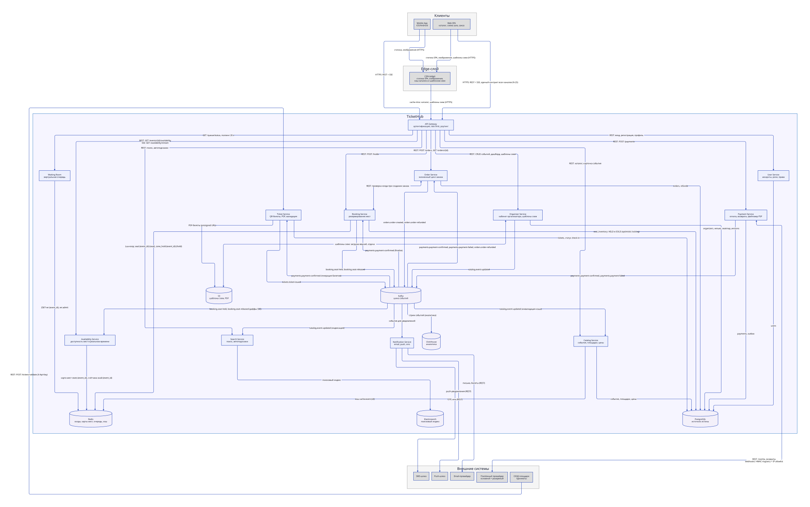

# 5. Взаимодействие сервисов и API-контракты

## 5.1 Схема взаимодействия



Исходник: [diagrams/service-interactions.d2](../diagrams/service-interactions.d2) (D2, layout: ELK). Схема на уровне контейнеров; на каждой связи подписан протокол и контракт взаимодействия (REST-эндпоинт, SSE-поток, топик Kafka).

Синхронно (REST/SSE, через API Gateway): клиенты читают каталог, поиск и доступность мест; бронь, заказ и инициация платежа. Асинхронно (Kafka): `Booking/Order/Payment/Ticket/Notification` обмениваются доменными событиями — webhook PSP приходит в Payment, оттуда событием `payments.payment-confirmed` уходит в Booking (перевод мест в `SOLD`), Ticket (генерация билетов) и Notification. СКУД площадок вызывает Ticket Service напрямую (валидация QR), минуя клиентский шлюз.

## 5.2 Выбор протоколов

| Связь | Протокол | Почему |
| --- | --- | --- |
| Клиент ↔ API Gateway | HTTPS/REST + JSON | Простота, кэшируемость CDN, единый контракт для всех каналов продаж (сайт, VK, Telegram — N-25) |
| Схема зала: доступность мест | SSE `GET /api/v1/events/{id}/availability/stream` | Живые статусы нельзя кэшировать (ADR-004) — клиент накладывает диффы поверх геометрии. Однонаправленный SSE проще WebSocket: сервер сам присылает только изменившиеся места, клиенту не нужен опрос каждые 5 с. Соединения (десятки тысяч) терминируются на edge/gateway, Availability отдаёт коалесцированный поток диффов (~8 000 обновлений/с, 3.2) |
| Waiting room | Polling `GET /queue/status` раз в 20 с | Очередь не требует real-time: «позиция 14 582 из 40 000» раз в 20 с достаточно. 400 тыс. ожидающих дают ~20 000 RPS дешёвых stateless-запросов к ZSET в Redis (3.2); держать 400 тыс. долгоживущих соединений (память, лимиты fd и балансировщиков, переподключения на мобильных) ради ожидания в 10–20 минут не нужно |
| Gateway ↔ сервисы | REST/JSON (синхронно) | Читаемые контракты, стандартные балансировщики; latency read-path критична — без лишних брокеров на пути чтения |
| Доменные события (write-path) | Kafka + Avro + Schema Registry | Буферизация всплесков, гарантии доставки, replay для проекций (поиск, аналитика, rebuild Redis) |
| Payment ↔ PSP | REST + подписанные webhooks | Стандарт индустрии PSP; webhook = источник истины о платеже |

**Правило:** все операции с деньгами и местами после подтверждения — асинхронные через события; все пользовательские чтения — синхронные.

**Политика транспорта:** долгоживущее соединение — только там, где без него теряется качество: live-статусы мест в booking-path отдаём по SSE (однонаправленный поток, десятки тысяч соединений терминируются на edge/gateway, до бизнес-сервисов доходит только поток диффов). Очередь и все остальные сценарии — короткие request/response: 400 тыс. ожидающих дешевле опрашивать раз в 20 с, чем держать 400 тыс. соединений. Внутренние вызовы — REST/JSON: пиковый high-throughput разрулен в Redis (холды и карта мест, ADR-001), на долю межсервисных вызовов остаются единицы RPS, поэтому отдельный бинарный протокол (gRPC) не вводим.

## 5.3 Ключевые API-контракты

### 1 Создание холда (Booking Service)

```text
POST /api/v1/holds
Authorization: Bearer <JWT>
Idempotency-Key: 9f2c…  (UUID, обязателен)

{
  "event_id": "evt_12345",
  "seat_ids": ["A-12-05", "A-12-06"]
}

201 Created
{
  "hold_id": "h_abc",
  "expires_at": "2026-09-10T19:10:00Z",
  "total_price": { "amount": 600000, "currency": "RUB" },
  "seats": [ {"seat_id": "A-12-05", "price": 300000}, ... ]
}

409 Conflict — одно или несколько мест заняты:
{ "error": "SEATS_UNAVAILABLE", "unavailable": ["A-12-06"] }
```

Семантика: покупатель берётся из JWT — `user_id` в теле не передаём, доверять клиенту его нельзя. Атомарная Lua-операция в Redis (`SET seat:{ev}:{id} {hold_id} NX PX 600000` по каждому месту в одном скрипте — либо все места, либо ни одного). TTL 600 сек — он же дедлайн оплаты. Идемпотентность: повтор с тем же `Idempotency-Key` возвращает существующий холд. Для стоячих зон (F-C-05) вместо `seat_ids` передаётся `{ "zone_id": "F", "qty": 2 }` — логика холда та же (ADR-001).

### 2) Создание заказа (Order Service)

```text
POST /api/v1/orders
Authorization: Bearer <JWT>
Idempotency-Key: …

{ "hold_id": "h_abc" }

201 Created
{
  "order_id": "ord_987",
  "status": "PENDING_PAYMENT",
  "expires_at": "2026-09-10T19:10:00Z"
}

GET /api/v1/orders/{order_id}
→ 200 OK
{
  "order_id": "ord_987",
  "status": "PENDING_PAYMENT | PROCESSING | PAID | PAYMENT_FAILED | CANCELLED | REFUNDED",
  "total": { "amount": 600000, "currency": "RUB" },
  "tickets": [ {"ticket_id": "t_1", "pdf_url": "https://…"} ]
}
```

Семантика: заказ создаётся в статусе `PENDING_PAYMENT`; контакты покупателя берутся из профиля, тело несёт только `hold_id`. Order Service проверяет, что холд жив и не истёк (синхронный вызов Booking Service). Ссылка на оплату здесь **не возвращается** — инициация платежа отдельный шаг (см. 3). Сбой платёжного контура не мешает созданию заказа. После инициации платежа заказ переходит в `PROCESSING` (состоянием управляет Saga-оркестратор, ADR-003), финал — `PAID` или `PAYMENT_FAILED` (при неуспехе холд освобождается); `CANCELLED` — отмена до оплаты, `REFUNDED` — возврат после оплаты. `GET /orders/{id}` — способ узнать асинхронный результат оплаты и получить билеты (N-12): клиент опрашивает его после возврата с PSP, а результат дополнительно приходит пушем (F-C-13).

### 3) Инициация платежа (Payment Service)

```text
POST /api/v1/payments
Authorization: Bearer <JWT>
Idempotency-Key: …

{ "order_id": "ord_987" }

202 Accepted
{
  "payment_id": "pay_555",
  "order_id": "ord_987",
  "status": "PENDING",
  "payment_url": "https://psp.example/pay/…",
  "expires_at": "2026-09-10T19:10:00Z"
}
```

Семантика: `202 Accepted` — запрос принят, финальный результат придёт асинхронно (ADR-003); клиент узнаёт его поллингом `GET /orders/{id}` (см. 2) или пушем. Payment Service сам выбирает провайдера (основной/резервный, фейловер по error-rate), создаёт платёжную сессию и возвращает `payment_url` — клиент перенаправляется на страницу PSP / 3DS. Повтор с тем же `Idempotency-Key` возвращает существующую платёжную сессию (не создаёт вторую). Результат оплаты — только асинхронно, webhook'ом (см. 4) и событием `payments.payment-confirmed`.

Пользовательский сценарий: выбор мест → «Далее» (`POST /holds`) → экран подтверждения с местами и суммой → «Оплатить» (`POST /orders`, затем `POST /payments`) → редирект на PSP.

### 4) Подтверждение оплаты — webhook PSP → Payment Service

```text
POST /internal/webhooks/psp/{provider}
X-PSP-Signature: <HMAC-SHA256 тела запроса>

{
  "payment_id": "psp_pay_555",
  "order_id": "ord_987",
  "status": "succeeded",
  "amount": 600000, "currency": "RUB"
}

200 OK (идемпотентно: повторный webhook — no-op)
```

Проверка подписи обязательна; расхождение суммы → алерт + ручная сверка. По успеху публикуется событие `PaymentConfirmed` (через outbox, атомарно с записью статуса).

### 5) Доступность мест (Availability Service)

```text
GET /api/v1/events/{event_id}/availability?sector=A
→ 200 OK
{
  "event_id": "evt_12345",
  "version": 182345,
  "sectors": [
    { "sector": "A", "free": 120, "price_from": 250000,
      "seats": [ {"id": "A-12-05", "status": "held"}, ... ] }
  ]
}

SSE GET /api/v1/events/{event_id}/availability/stream?sector=A
Last-Event-ID: 182345        // при переподключении — догнать с этой версии
event: seat_update
data: {"seat_id":"A-12-06","status":"sold","version":182346}
```

Семантика: `GET` — начальный снимок сектора (первый рендер); SSE — сервер пушит только изменившиеся места (`FREE | HELD | SOLD | BLOCKED`). `version` — монотонный счётчик карты мест события в Redis: по нему клиент отбрасывает устаревшие события, а `Last-Event-ID` даёт догнать пропущенное после обрыва связи. Полная геометрия зала приходит отдельно из CDN-кэша (см. 6).

### 6) Схема зала (Organizer Service)

```text
GET /api/v1/venues/{venue_id}/seatmap/v{n}
→ 200 OK
<JSON шаблона: геометрия секторов/рядов/мест, без цен и статусов (4.2.3)>
Cache-Control: public, max-age=31536000, immutable
```

Семантика: публичный read-endpoint библиотеки шаблонов, аутентификация не нужна. Ключ иммутабелен (версия в URL), поэтому ответ кэшируется в CDN edge навсегда — до Origin (Organizer Service → S3) доходят только cache-miss. Клиент получает номер версии из карточки события (`seatmap_version`) и накладывает поверх геометрии статусы из Availability (5.3-5, SSE-поток).

### 7) Валидация билета на входе (Ticket Service, для СКУД)

```text
POST /api/v1/tickets/validate
X-Api-Key: <ключ площадки или события>

{ "qr_payload": "eyJ0aWNrZXRfaWQi…", "qr_sign": "…", "gate": "North-3" }

200 OK  { "result": "OK", "seat": "A-12-05", "holder_masked": "И*** П***" }
200 OK  { "result": "ALREADY_CHECKED_IN", "checked_in_at": "18:42:11" }
200 OK  { "result": "INVALID" }   // билет возвращён / отозван
```

Подпись QR: `Ed25519` — приватный ключ в Vault, публичный зашит в устройство СКУД, поэтому устройство проверяет подпись офлайн (F-E-01, F-C-10), а сервер — статус билета и фиксирует check-in в PostgreSQL. Повторный проход отклоняется условным обновлением статуса (`ISSUED → USED` с проверкой текущего статуса): если билет уже `USED`, возвращается `ALREADY_CHECKED_IN`. Отметки check-in буферизуются и применяются батчами — несколько записей в одной транзакции (процедуре), что сглаживает пик входа (≈15 RPS, 80 000 человек за 1,5 ч — 3.2) и укладывается в SLA онлайн-проверки (N-08). Redis для check-in не нужен: объём отметок невелик, а источник истины по билетам — PostgreSQL. Ротация ключа — по runbook при компрометации + перевыпуск манифестов (07.3).

## 5.4 События Kafka (основные)

Именование: топик — `{домен}.{сущность}-{действие}` (kebab-case), а тип события в схеме Avro — PascalCase того же действия (например, топик `payments.payment-confirmed` ↔ тип `PaymentConfirmed`, `catalog.event-updated` ↔ `EventUpdated`). В колонке Producer → Consumers указаны топики; в тексте разделов тип события и его топик — это одно и то же событие. На схемах взаимодействия (5.1 и 2.1) события подписаны именами топиков.

| Топик | Producer → Consumers | Payload (Avro, ключевые поля) |
| --- | --- | --- |
| `booking.seat-held` | Booking → Availability, Analytics | hold_id, event_id, seat_ids[], expires_at |
| `booking.seat-released` | Booking (TTL-expiry sweeper) → Availability | hold_id, event_id, seat_ids[], reason |
| `orders.order-created` | Order → Analytics | order_id, hold_id, amount, expires_at |
| `payments.payment-confirmed` | Payment → Booking (finalize), Ticket, Order, Notification | order_id, payment_id, amount, paid_at |
| `payments.payment-failed` | Payment → Order, Notification | order_id, reason, attempt |
| `tickets.ticket-issued` | Ticket → Notification, Analytics | ticket_id, order_id, pdf_url, qr_version |
| `orders.order-refunded` | Order → Payment (refund), Ticket (revoke), Notification | order_id, amount, reason |
| `catalog.event-updated` | Organizer → Search, Cache invalidator, Analytics | event_id, version, changed_fields[] |

Гарантии: transactional outbox из PostgreSQL → релей в Kafka (at-least-once); консьюмеры идемпотентны (ключ `event_id` + таблица processed_ids).
